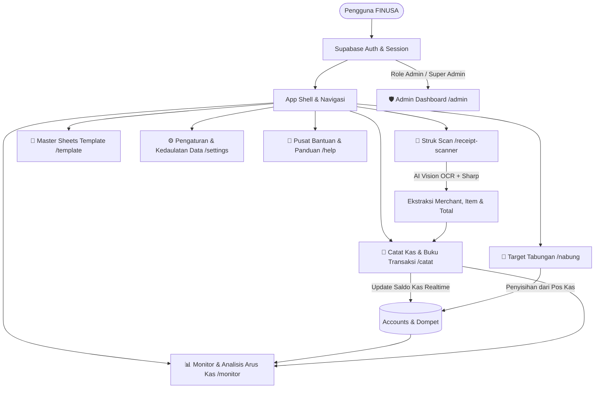
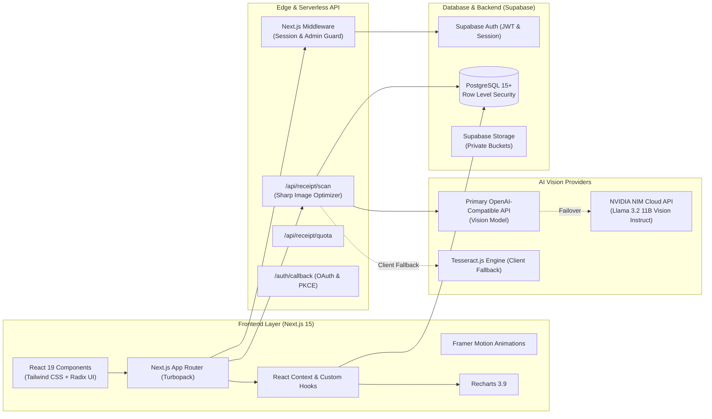

<p align="center">
  
</p>

<h1 align="center">FINUSA (Finance Nusantara) </h1>

<p align="center">
  <strong>Platform Manajemen Keuangan Pribadi & Smart Receipt OCR Berbasis AI Terapan</strong><br />
  Solusi pencatatan kas harian modern, pemisahan pos tabungan kompartemen, analisis arus kas interaktif, dan integrasi ekosistem spreadsheet yang dirancang khusus untuk generasi muda, pelajar, first-jobber, dan profesional mandiri di Indonesia.
</p>

<p align="center">
  <a href="https://nextjs.org"></a>
  <a href="https://react.dev"></a>
  <a href="https://www.typescriptlang.org"></a>
  <a href="https://supabase.com"></a>
  <a href="https://tailwindcss.com"></a>
  <a href="https://nvidia.com"></a>
  <a href="#lisensi"></a>
</p>

---

## 📑 Daftar Isi

- [Tentang FINUSA](#-tentang-finusa)
  - [Latar Belakang & Masalah](#latar-belakang--masalah)
  - [Prinsip Desain & Filosofi Produk](#prinsip-desain--filosofi-produk)
- [Fitur Utama & Modul Sistem](#-fitur-utama--modul-sistem)
  - [1. Smart OCR Receipt Scanner](#1-smart-ocr-receipt-scanner-core-mvp---receipt-scanner)
  - [2. Catat Kas & Pembukuan Transaksi](#2-catat-kas--pembukuan-transaksi-catat--pembukuan)
  - [3. Target Tabungan & Celengan Impian](#3-target-tabungan--celengan-impian-nabung)
  - [4. Monitor & Analisis Arus Kas](#4-monitor--analisis-arus-kas-monitor)
  - [5. Master Spreadsheet Ecosystem](#5-master-spreadsheet-ecosystem-template)
  - [6. Admin Management Portal](#6-admin-management-portal-admin)
  - [7. Pengaturan Akun, Privasi & Kedaulatan Data](#7-pengaturan-akun-privasi--kedaulatan-data-settings)
  - [8. Pusat Bantuan & Edukasi Finansial](#8-pusat-bantuan--edukasi-finansial-help--bantuan)
- [Arsitektur Teknis & Tech Stack](#-arsitektur-teknis--tech-stack)
- [Struktur Direktori Repositori](#-struktur-direktori-repositori)
- [Panduan Instalasi & Menjalankan Proyek](#-panduan-instalasi--menjalankan-proyek)
  - [Prasyarat Sistem](#prasyarat-sistem)
  - [Langkah 1: Clone Repositori](#langkah-1-clone-repositori)
  - [Langkah 2: Install Dependensi](#langkah-2-install-dependensi)
  - [Langkah 3: Konfigurasi Environment Variables](#langkah-3-konfigurasi-environment-variables)
  - [Langkah 4: Setup Database Supabase](#langkah-4-setup-database-supabase)
  - [Langkah 5: Jalankan Server Development](#langkah-5-jalankan-server-development)
- [Konfigurasi Administrator (Role Management)](#-konfigurasi-administrator-role-management)
- [Keamanan & Kebijakan Privasi Data](#-keamanan--kebijakan-privasi-data)
- [Panduan Kontribusi (Open Source)](#-panduan-kontribusi-open-source)
- [Lisensi](#-lisensi)

---

## 💡 Tentang FINUSA

**FINUSA (Finance Nusantara)** adalah aplikasi web open-source manajemen keuangan personal dan pembukuan kas yang dikembangkan dengan fokus utama pada kecepatan pencatatan, transparansi arus kas tanpa jargon perbankan yang kaku, serta kecerdasan buatan terapan (*applied AI*).

### Latar Belakang & Masalah

1. **Keengganan Mencatat Manual:** Sebagian besar orang gagal mengelola keuangan karena lelah mengetik rincian setiap struk belanjaan fisik (minimarket, supermarket, kafe, SPBU) satu per satu.
2. **Kebocoran Kas Mikro Tak Terdeteksi:** Gaji atau uang saku sering habis di tengah bulan tanpa jejak karena ketiadaan visualisasi yang jelas antara kas masuk vs kas keluar dan pos pengeluaran terbesar.
3. **Tabungan yang Kerap Terpakai:** Menabung tanpa target nominal spesifik dan tanpa kompartemen terisolasi berakhir dengan dana simpanan yang terpakai untuk belanja konsumtif impulsif.
4. **Birokrasi & Jargon Perbankan Rumit:** Aplikasi finansial konvensional seringkali membebani pengguna dengan jargon akuntansi berat (rekonsiliasi mutasi rekening koran, debet/kredit rumit) yang justru membingungkan pemula.

### Prinsip Desain & Filosofi Produk

- **Practical Applied AI over Speculative Chatbots:** Mengganti konsep AI Chatbot percakapan yang lambat dan rawan halusinasi dengan **Smart OCR Vision** terapan yang memotong waktu input struk belanja dari beberapa menit menjadi hanya beberapa detik.
- **Zero Bank Lock-in:** Pengguna memegang kendali penuh atas pos kas, rekening, dan dompet digital mereka tanpa harus menautkan kredensial rahasia bank pihak ketiga.
- **Isolasi Kompartemen Tabungan:** Setiap target tabungan memiliki ruang virtual sendiri sehingga saldo tabungan tidak tercampur sebagai uang bebas belanja.
- **Desain Modern & Ramah Mata:** Mengusung tema gelap elegan (*Warm Dark Neutral* `#0F1419`) dengan aksen bersih, tipografi angka monospaced berpresisi tinggi (`tabular-nums`), dan transisi halus berbasis hardware-accelerated CSS & Framer Motion.

---

## ✨ Fitur Utama & Modul Sistem



### 1. Smart OCR Receipt Scanner (Core MVP - `/receipt-scanner`)

Fitur unggulan FINUSA yang mengubah kamera ponsel atau komputer pengguna menjadi pemindai bukti belanja otomatis.

- **Dual-Engine Multimodal Vision AI:**
  - *Primary Provider:* Endpoint OpenAI-compatible berperforma tinggi (default: Qwen Vision / model kustom).
  - *Failover Provider:* NVIDIA NIM API menggunakan model `meta/llama-3.2-11b-vision-instruct` (cadangan otomatis jika provider utama antre atau mengalami gangguan jaringan).
  - *Fallback / Demo Engine:* Tesseract.js dan simulasi pintar offline untuk stabilitas pengujian.
- **Pra-pemrosesan Citra Cerdas (Sharp Engine):**
  - Normalisasi resolusi cerdas (960×960 px untuk efisiensi transfer data).
  - Penajaman kontras dan *unsharp masking* otomatis untuk membaca struk kertas termal yang pudar atau berbayang.
- **Ekstraksi Entitas Transaksi Lengkap:**
  - Nama toko/merchant.
  - Tanggal dan jam transaksi (otomatis mengoreksi format ke waktu lokal pengguna).
  - Rincian item belanja (nama produk, kuantitas, harga satuan, dan subtotal per baris).
  - Klasifikasi kategori otomatis per item (*Makan, Kebutuhan, Transportasi, Cicilan, Keinginan, Lainnya*).
  - Perhitungan pajak (PPN), diskon belanja, dan nominal total akhir.
  - Deteksi metode pembayaran (Tunai, QRIS, E-Wallet, Transfer Bank).
- **Layar Validasi Interaktif (Review & Edit):**
  - Pengguna dapat memvalidasi, menambah, menghapus, atau mengoreksi rincian item sebelum data dimasukkan ke pembukuan.
- **Kebijakan Zero-Retention Storage:**
  - Gambar struk hanya diproses di memori serverless runtime untuk OCR, tidak disimpan secara permanen di storage publik guna melindungi privasi belanja pengguna.

### 2. Catat Kas & Pembukuan Transaksi (`/catat` & `/pembukuan`)

Sistem pencatatan transaksi terstruktur yang menggabungkan kemudahan buku kas harian dengan akurasi akuntansi personal.

- **Buku Transaksi Interaktif (Ledger):**
  - Tampilan tabel desktop kaya data dan kartu riwayat transaksi responsif untuk perangkat mobile.
  - Mendukung transaksi **Pengeluaran (Expense)**, **Pemasukan (Income)**, dan **Transfer Antar Pos Kas**.
- **Quick Add Bar Satu Baris:**
  - Input instan untuk mencatat transaksi spontan dalam hitungan detik tanpa membuka modal formulir lengkap.
- **Filter Multi-Kondisi & Pencarian Cepat:**
  - Filter berdasarkan rentang tanggal, kategori, akun/dompet, jenis transaksi, dan status (*Completed / Pending*).
  - Pencarian instan berdasarkan nama merchant, deskripsi, atau nominal.
- **Operasi Massal (Bulk Actions):**
  - Pemilihan banyak transaksi sekaligus (*multi-select*).
  - Hapus transaksi massal dengan *automatic rollback* saldo kas terkait.
  - Ubah status transaksi massal (*completed/pending*).
- **Manajemen Kategori Fleksibel:**
  - Buat, ubah, dan hapus kategori pos pengeluaran/pemasukan.
  - Pemilihan ikon visual dan kode warna kustom.
  - Sistem *auto-seeding* kategori standar Indonesia jika kategori pengguna belum terisi.
- **Pencatatan Otomatis Berulang (Recurring Transactions):**
  - Penjadwalan transaksi rutin (sewa kos/rumah, langganan internet, tagihan listrik, cicilan bulanan).
  - Frekuensi harian, mingguan, bulanan, atau tahunan dengan eksekusi otomatis.
- **Impor & Ekspor Data:**
  - *Bulk Import CSV:* Unggah berkas CSV historis dari aplikasi lain atau mutasi manual dengan pemetaan kolom interaktif.
  - *Ekspor Data:* Unduh riwayat pembukuan dalam format **CSV**, **JSON**, atau **PDF ringkasan berformat elegan**.

### 3. Target Tabungan & Celengan Impian (`/nabung`)

Pendekatan gamifikasi untuk membantu pengguna membangun kebiasaan menabung yang disiplin dan terarah.

- **Kompartemen Target Terisolasi:**
  - Buat pos tabungan mandiri (misal: *Dana Darurat 6 Bulan*, *Laptop Baru*, *Modal Usaha*, *Liburan Akhir Tahun*).
  - Setiap target memiliki warna personal, ikon, pagu nominal, dan batas waktu target (*deadline*).
- **Visual Progress Ring:**
  - Visualisasi persentase capaian yang dinamis dan modern.
  - Estimasi sisa hari, sisa nominal yang harus dikumpulkan, serta kecepatan menabung yang disarankan.
- **Setor Dana Mandiri (Add Money):**
  - Menambah tabungan secara langsung dengan opsi memotong saldo pos kas sumber (Kas Operasional, Dompet Digital, Kas Tunai) atau setoran langsung.
- **Penarikan Dana (Withdraw Money):**
  - Opsi pencairan tabungan ketika target terpenuhi atau saat keadaan mendesak dengan pencatatan audit trail yang rapi.
- **Simulator Auto-Save:**
  - Kalkulator bawaan yang secara otomatis menghitung berapa nominal yang harus disisihkan setiap hari, minggu, atau bulan agar target tercapai tepat waktu.
- **Milestone Celebration Modal:**
  - Animasi perayaan interaktif yang muncul ketika tabungan menembus milestone psikologis **25%**, **50%**, **75%**, dan **100%**.

### 4. Monitor & Analisis Arus Kas (`/monitor`)

Pusat kendali analitis untuk membaca kesehatan finansial secara holistik.

- **5 Indikator Finansial Utama (KPI Metrics):**
  - *Total Saldo Kas Terkonsolidasi:* Akumulasi saldo riil dari seluruh akun dan dompet aktif.
  - *Net Cashflow:* Selisih bersih antara arus kas masuk dan kas keluar (indikator surplus/defisit bulanan).
  - *Total Pemasukan & Pertumbuhan (% MoM).*
  - *Total Pengeluaran & Perbandingan Periode Sebelumnya.*
  - *Tingkat Tabungan (Saving Rate %):* Rasio kas yang berhasil disimpan dibanding total penghasilan.
- **Grafik Batang Arus Kas Bulanan (Recharts):**
  - Visualisasi interaktif perbandingan Pemasukan vs Pengeluaran dari bulan ke bulan.
  - Tooltip informatif dan rendering grafik berkinerja tinggi.
- **Diagram Donat Alokasi Belanja:**
  - Distribusi persentase pengeluaran per kategori untuk mendeteksi pos belanja terbesar secara seketika.
- **Filter Periode Dinamis:**
  - Pilihan rentang analisis: *Bulan Ini, Bulan Lalu, Tahun Ini, atau Sepanjang Waktu*.
- **Ringkasan Saldo Kompartemen:**
  - Pantau kesehatan saldo di setiap dompet (Dompet Utama, Kas Operasional, Dompet Digital, Uang Tunai).

### 5. Master Spreadsheet Ecosystem (`/template`)

Bagi pengguna yang menyukai kebebasan olah data mendalam menggunakan rumus dan spreadsheet, FINUSA menyediakan ekosistem master spreadsheet resmi:

- **Master Template Google Sheets & Excel (`.xlsx`):**
  - Dokumen *Financial Freedom Management* resmi siap pakai yang berada di direktori `TemplateSheets/`.
- **Modul Spreadsheet Terintegrasi:**
  1. *Executive Financial Dashboard:* Ringkasan neraca kas tahunan.
  2. *50/30/20 Budgeting Calculator:* Alokasi ideal Kebutuhan (50%), Keinginan (30%), dan Tabungan/Investasi (20%).
  3. *Debt Snowball Elimination Tracker:* Strategi pelunasan hutang terarah.
  4. *Wealth & Net Worth Tracker:* Pemantauan aset dan pertumbuhan kekayaan jangka panjang.
- **Panduan Visual Langkah-demi-Langkah:**
  - Panduan terintegrasi langsung di aplikasi untuk menyalin template ke akun Google Drive pribadi pengguna hanya dalam 3 langkah mudah.

### 6. Admin Management Portal (`/admin`)

Panel kendali administratif bawaan untuk memantau performa platform, kesehatan sistem, dan basis pengguna.

- **Perlindungan Akses Ganda (Dual-Layer Guard):**
  - Validasi middleware Next.js berbasis daftar putih email di Environment Variable (`ADMIN_EMAILS`).
  - Validasi tingkat database melalui kolom `system_role IN ('admin', 'super_admin')` pada tabel `profiles` dengan fungsi PostgreSQL *Security Definer*.
- **Metrik Platform Realtime:**
  - Total pengguna terdaftar, pengguna aktif harian/bulanan, total volume transaksi yang diproses, dan status integritas sistem.
- **Tabel Manajemen Pengguna:**
  - Pencarian dan filter pengguna berdasarkan nama, email, dan peran (*Admin* vs *User*).
  - Pembaruan hak akses peran pengguna dengan modal konfirmasi keamanan.
  - Indikator status login terakhir (*last_seen_at*).
- **Panduan Setup & Dokumentasi SQL Interaktif:**
  - Skrip migrasi cepat dan petunjuk konfigurasi super admin langsung dari dashboard.

### 7. Pengaturan Akun, Privasi & Kedaulatan Data (`/settings`)

- **Manajemen Profil:** Nama lengkap, nomor telepon, peran/persona (Pelajar, Fresh Graduate, Profesional, Pebisnis), bio, dan foto avatar.
- **Keamanan Kata Sandi:** Pembaruan sandi akun dengan verifikasi sandi lama terlebih dahulu untuk mencegah pembajakan akun (*anti-account takeover*).
- **Preferensi Regional:** Pilihan zona waktu lokal Indonesia (**WIB**, **WITA**, **WIT**) agar stempel waktu transaksi selalu akurat.
- **Kedaulatan & Penghapusan Data Mandiri:**
  - *Ekspor Data Lengkap:* Unduh seluruh data profil, akun, kategori, dan transaksi ke berkas JSON atau CSV.
  - *Kosongkan Transaksi:* Reset riwayat pembukuan kas tanpa menghapus akun.
  - *Hapus Akun Permanen:* Menghapus akun secara permanen dengan *cascade cleanup* ke seluruh tabel database dan pembersihan cache lokal browser.

### 8. Pusat Bantuan & Edukasi Finansial (`/help` & `/bantuan`)

Pusat dokumentasi terstruktur yang mencakup 16+ artikel mendalam dengan panduan visual, rincian formulir, tips literasi keuangan, dan solusi masalah teknis (*troubleshooting*).

---

## 🏗️ Arsitektur Teknis & Tech Stack



### Rincian Dependensi Utama

| Kategori | Teknologi | Deskripsi |
|---|---|---|
| **Core Framework** | [Next.js](https://nextjs.org) 15.1.3 | React Framework dengan App Router, Turbopack, dan SSR |
| **UI Library** | [React](https://react.dev) 19.0.0 | Rendering antarmuka berbasis komponen modern |
| **Bahasa Pemrograman** | [TypeScript](https://www.typescriptlang.org) 5.7.2 | Type safety end-to-end |
| **Styling & Desain** | [Tailwind CSS](https://tailwindcss.com) 3.4.17 | Utility-first CSS framework |
| **Primitif Komponen** | [Radix UI](https://www.radix-ui.com) | Accessible, unstyled UI primitives (Avatar, Dialog, Label, Slot) |
| **Animasi** | [Framer Motion](https://www.framer.com/motion) 11.15.0 | Transisi antarmuka, layout animations, dan modal |
| **Grafik & Visualisasi** | [Recharts](https://recharts.org) 3.9.2 | Visualisasi grafik batang arus kas dan donat kategori |
| **Ikonografi** | [Lucide React](https://lucide.dev) 0.468.0 | Paket ikon SVG modern dan konsisten |
| **Backend as a Service** | [Supabase](https://supabase.com) 2.110.1 | PostgreSQL 15, SSR Auth (`@supabase/ssr`), dan Row Level Security |
| **Image Processing** | [Sharp](https://sharp.pixelplumbing.com) 0.34.5 | Manipulasi dan optimasi citra struk sebelum dikirim ke AI |
| **AI Vision Engine** | [NVIDIA NIM](https://build.nvidia.com) | Multimodal Vision AI (`meta/llama-3.2-11b-vision-instruct`) |
| **Client OCR Fallback** | [Tesseract.js](https://tesseract.projectnaptha.com) 7.0.0 | Pemrosesan OCR lokal berbasis JavaScript |
| **Spreadsheet Engine** | [ExcelJS](https://github.com/exceljs/exceljs) 4.4.0 | Pembacaan dan pembuatan berkas spreadsheet XLSX |

---

## 📁 Struktur Direktori Repositori

```text
finusa/
├── backend/                       # Workspace backend (stub/reservasi untuk microservices masa depan)
│   ├── src/
│   └── package.json
│
├── frontend/                      # Aplikasi utama Next.js 15
│   ├── public/                    # Aset statis, ikon, logo, panduan sheets
│   │   ├── Assets/
│   │   ├── favicon.ico
│   │   ├── icon-192.png
│   │   └── icon-512.png
│   │
│   ├── src/
│   │   ├── app/                   # Next.js App Router
│   │   │   ├── (admin)/           # Rute Administratif
│   │   │   │   └── admin/         # Dashboard admin, metrik platform, tabel pengguna
│   │   │   │       └── components/# Komponen modular admin
│   │   │   │
│   │   │   ├── (app)/             # Rute Aplikasi Terproteksi
│   │   │   │   ├── home/          # Dashboard ringkasan finansial utama
│   │   │   │   ├── catat/         # Buku kas transaksi, quick add, filter, recurring
│   │   │   │   ├── pembukuan/     # Rute alias untuk catat transaksi
│   │   │   │   ├── nabung/        # Target tabungan, auto-save simulator, milestones
│   │   │   │   ├── monitor/       # Analisis arus kas, grafik Recharts, breakdown kategori
│   │   │   │   ├── receipt-scanner/# Smart OCR Scanner (kamera, preview, konfirmasi)
│   │   │   │   ├── template/      # Master spreadsheet Google Sheets & Excel XLSX
│   │   │   │   ├── settings/      # Profil, keamanan password, zona waktu, hapus data
│   │   │   │   └── help/          # Halaman pengantar bantuan
│   │   │   │
│   │   │   ├── api/               # Serverless API Routes
│   │   │   │   └── receipt/       # Endpoint /api/receipt/scan & /api/receipt/quota
│   │   │   │
│   │   │   ├── auth/              # Alur Otentikasi Supabase
│   │   │   │   ├── login/         # Halaman login
│   │   │   │   ├── signup/        # Halaman pendaftaran akun baru
│   │   │   │   ├── forgot-password/# Permintaan reset kata sandi via email
│   │   │   │   ├── reset-password/ # Formulir pembaruan kata sandi baru
│   │   │   │   └── callback/      # OAuth callback handler & token exchange
│   │   │   │
│   │   │   ├── bantuan/           # Pusat Bantuan Publik & Dokumentasi Mendalam
│   │   │   │   ├── [slug]/        # Dynamic route artikel bantuan finansial
│   │   │   │   └── page.tsx
│   │   │   │
│   │   │   ├── privacy/           # Halaman Kebijakan Privasi
│   │   │   ├── layout.tsx         # Root layout & font loader
│   │   │   ├── page.tsx           # Modern dark landing page
│   │   │   └── globals.css        # Variabel tema Tailwind & utility classes
│   │   │
│   │   ├── components/            # Komponen landing page dan UI umum
│   │   │   ├── sections/          # Hero, trust ticker, features, deep-dive scan, cta
│   │   │   ├── seo/               # Schema markup JsonLd.tsx
│   │   │   └── ui/                # Floating nav, progress bar, reveal animations
│   │   │
│   │   ├── lib/                   # Layanan & Business Logic
│   │   │   ├── auth/              # Supabase client (browser, server, middleware, admin)
│   │   │   ├── context/           # UserProfileContext
│   │   │   ├── data/              # help-data.ts (16+ artikel bantuan komprehensif)
│   │   │   └── services/          # Service layer Supabase
│   │   │       ├── admin.service.ts
│   │   │       ├── analytics.service.ts
│   │   │       ├── notification.service.ts
│   │   │       ├── pembukuan.service.ts
│   │   │       ├── savings.service.ts
│   │   │       └── settings.service.ts
│   │   │
│   │   ├── shared/                # Komponen dan pustaka yang digunakan bersama
│   │   │   ├── components/        # Navbar, footer, dashboard sidebar
│   │   │   ├── context/           # ThemeContext
│   │   │   ├── hooks/             # useCamera, useReceiptScanner, useImageOptimizer
│   │   │   └── lib/               # Utilitas format uang, tanggal, dan AI extract
│   │   │       └── receipt/       # nvidia-models.ts, extract.ts, resize-image.ts
│   │   │
│   │   └── middleware.ts          # Global Auth & Role Guard Middleware
│   │
│   ├── .env.example               # Contoh konfigurasi environment variable
│   ├── package.json
│   ├── tailwind.config.js
│   └── tsconfig.json
│
├── supabase/                      # Konfigurasi Database Supabase
│   └── migrations/                # Berkas SQL migrasi skema & RLS
│       ├── full_finusa_schema.sql # Skema 14 tabel lengkap + relasi + trigger
│       ├── 00_definitive_auth_fix.sql
│       ├── 01_security_hardening.sql # Pengetatan RLS & pencabutan izin anonim
│       └── 02_simple_admin_setup.sql # Setup sistem role admin & fungsi is_admin()
│
├── TemplateSheets/                # Berkas Master Spreadsheet Resmi FINUSA
│   ├── FINUSA_Financial_Management_Master.xlsx
│   ├── FINUSA_Master_Template_Keuangan_Pribadi.xlsx
│   ├── SETUP_TEMPLATE_STEP_BY_STEP.md
│   └── FINUSA_TEMPLATE_GUIDE.md
│
├── FinusaPRD.md                   # Product Requirement Document Utama
├── PembukuanPRD.md                # PRD Spesifik Modul Pembukuan
├── SaveMoneyPRD.md                # PRD Spesifik Modul Target Tabungan
├── SheetIntegrationPRD.md         # PRD Integrasi Spreadsheet
├── package.json                   # Root monorepo configuration
└── README.md                      # Dokumentasi proyek open-source ini
```

---

## 🚀 Panduan Instalasi & Menjalankan Proyek

Ikuti langkah-langkah di bawah ini untuk menjalankan FINUSA di komputer lokal Anda.

### Prasyarat Sistem

- **Node.js:** Versi `20.x` atau lebih baru (disarankan Node.js LTS).
- **Package Manager:** `npm` versi `10.x` ke atas.
- **Akun Supabase:** Proyek Supabase gratis untuk database PostgreSQL dan otentikasi.
- **Kredensial AI:** API Key dari [NVIDIA NIM](https://build.nvidia.com) (gratis kredit pengembang) atau endpoint OpenAI-compatible lainnya.

### Langkah 1: Clone Repositori

```bash
git clone https://github.com/Artaaaux/FINUSA-2.0
cd finusa
```

### Langkah 2: Install Dependensi

Jalankan perintah instalasi dari direktori root (npm workspaces akan menginstal dependensi seluruh monorepo):

```bash
npm install
```

### Langkah 3: Konfigurasi Environment Variables

Buka direktori `frontend/`, salin berkas `.env.example` menjadi `.env.local`:

```bash
cd frontend
cp .env.example .env.local
```

Buka `.env.local` dan lengkapi variabel berikut:

```env
# ==============================================================================
# SUPABASE CONFIGURATION
# Dapatkan URL & Anon Key di Supabase Dashboard -> Project Settings -> API
# ==============================================================================
NEXT_PUBLIC_SUPABASE_URL=https://proyek-anda.supabase.co
NEXT_PUBLIC_SUPABASE_ANON_KEY=eyJhbGciOiJIUzI1NiIsInR5cCI6IkpXVCJ9...

# ==============================================================================
# AI VISION ENGINE CONFIGURATION
# ==============================================================================
# 1. Primary AI Provider (Default: MecutinAI / custom OpenAI-compatible endpoint)
PRIMARY_AI_API_KEY=sk_kunci_primary_anda
PRIMARY_AI_API_ENDPOINT=https://mecutinai.com/api/v1
PRIMARY_AI_MODEL=qwen3.8-flash

# 2. Failover / Backup AI Provider (NVIDIA NIM)
# Jika primary gagal/timeout, FINUSA otomatis beralih ke NVIDIA NIM tanpa error di pengguna
NVIDIA_API_KEY=nvapi-kunci_nvidia_nim_anda
NVIDIA_API_ENDPOINT=https://integrate.api.nvidia.com/v1
NVIDIA_API_MODEL=meta/llama-3.2-11b-vision-instruct

# ==============================================================================
# APP METADATA & OAUTH
# ==============================================================================
NEXT_PUBLIC_APP_URL=http://localhost:3000
GOOGLE_CLIENT_ID=klien-id-google-anda.apps.googleusercontent.com
GOOGLE_CLIENT_SECRET=rahasia-klien-google-anda

# ==============================================================================
# ANTI-BOT PROTECTION (OPSIONAL)
# ==============================================================================
NEXT_PUBLIC_TURNSTILE_SITE_KEY=kunci-site-cloudflare-turnstile

# ==============================================================================
# ADMINISTRATOR PRIVILEGES
# Masukkan daftar email admin dipisahkan tanda koma
# ==============================================================================
ADMIN_EMAILS=admin@finusa.web.id,email-anda@gmail.com
NEXT_PUBLIC_ADMIN_EMAILS=admin@finusa.web.id,email-anda@gmail.com
```

### Langkah 4: Setup Database Supabase

Masuk ke **Supabase Dashboard** proyek Anda -> **SQL Editor** -> **New Query**, lalu jalankan skrip migrasi SQL dengan urutan berikut:

1. **Skema Utama (Wajib):**  
   Buka dan jalankan isi berkas [`supabase/migrations/full_finusa_schema.sql`](supabase/migrations/full_finusa_schema.sql). Skrip ini membuat 14 tabel (profiles, accounts, categories, transactions, recurring_transactions, savings_goals, dll.), mengonfigurasi relasi, trigger pendaftaran otomatis, dan kebijakan RLS dasar.
2. **Pengetatan Keamanan RLS (Wajib):**  
   Buka dan jalankan [`supabase/migrations/01_security_hardening.sql`](supabase/migrations/01_security_hardening.sql). Skrip ini mencabut akses tulis dari role anonim, mengisolasi bucket penyimpanan, dan memastikan *defense in depth*.
3. **Setup Sistem Admin (Wajib):**  
   Buka dan jalankan [`supabase/migrations/02_simple_admin_setup.sql`](supabase/migrations/02_simple_admin_setup.sql). Skrip ini menambahkan kolom `system_role`, fungsi keamanan `is_admin()`, serta kebijakan RLS khusus admin.

### Langkah 5: Jalankan Server Development

Kembali ke direktori root atau `frontend/`, jalankan perintah:

```bash
# Dari root monorepo:
npm run dev

# Atau langsung dari direktori frontend:
cd frontend
npm run dev
```

Buka peramban (browser) Anda dan akses:
- **Landing Page:** [http://localhost:3000](http://localhost:3000)
- **Halaman Masuk (Login):** [http://localhost:3000/auth/login](http://localhost:3000/auth/login)
- **Dashboard Finansial:** [http://localhost:3000/home](http://localhost:3000/home)
- **Struk Scan AI:** [http://localhost:3000/receipt-scanner](http://localhost:3000/receipt-scanner)
- **Portal Admin:** [http://localhost:3000/admin](http://localhost:3000/admin)

---

## 🛡️ Konfigurasi Administrator (Role Management)

Untuk membuka akses ke Portal Admin (`/admin`), ada dua langkah yang disarankan:

1. **Tambahkan Email ke `.env.local`:**
   ```env
   ADMIN_EMAILS=email-anda@gmail.com
   NEXT_PUBLIC_ADMIN_EMAILS=email-anda@gmail.com
   ```
2. **Promosikan Akun di Database Supabase:**
   Jalankan query SQL berikut di Supabase SQL Editor:
   ```sql
   UPDATE public.profiles 
   SET system_role = 'super_admin' 
   WHERE email = 'email-anda@gmail.com';
   ```

Setelah itu, login menggunakan email tersebut dan Anda dapat langsung mengakses rute `/admin` tanpa terhadang *Unauthorized Redirect*.

---

## 🔒 Keamanan & Kebijakan Privasi Data

FINUSA dibangun dengan memprioritaskan privasi dan keamanan finansial pengguna:

1. **Row Level Security (RLS) di Semua Tabel:**
   Setiap baris data (`profiles`, `accounts`, `transactions`, `savings_goals`, dll.) diisolasi menggunakan filter `auth.uid() = user_id`. Pengguna tidak dapat melihat atau memodifikasi data pengguna lain, bahkan jika melakukan panggilan API langsung.
2. **Revoked Anon Writes:**
   Seluruh izin tulis (`INSERT`, `UPDATE`, `DELETE`, `TRUNCATE`) dicabut dari role publik (`anon`) pada skema database.
3. **Zero-Retention Receipt Policy:**
   Gambar foto struk belanja yang diunggah diproses dalam memori oleh serverless runtime untuk diekstraksi oleh model AI Vision, lalu langsung dibersihkan tanpa disimpan di public cloud storage terbuka.
4. **Proteksi Password Re-Authentication:**
   Pengguna wajib memasukkan kata sandi saat ini sebelum dapat menyetel kata sandi baru untuk mencegah skenario *Account Takeover* pada perangkat bersama.
5. **Kedaulatan Data & Hak Dilupakan (Right to Be Forgotten):**
   Pengguna dapat mengekspor seluruh rekaman data mereka dalam format JSON/CSV kapan saja, serta dapat menghapus riwayat transaksi maupun menghapus akun secara permanen (*cascade deletion*) langsung dari menu Pengaturan.

---

## 🤝 Panduan Kontribusi (Open Source)

Kami menyambut kontribusi dari komunitas pengembang! Baik perbaikan bug, penambahan fitur, peningkatan dokumentasi, maupun penyempurnaan UI/UX.

### Alur Kontribusi:

1. **Fork** repositori ini ke akun GitHub Anda.
2. Buat branch baru untuk fitur atau perbaikan Anda:
   ```bash
   git checkout -b feat/nama-fitur-keren
   # atau
   git checkout -b fix/perbaikan-bug-tertentu
   ```
3. Lakukan perubahan kode dengan rapi dan pastikan mengikuti konvensi kode:
   - Gunakan TypeScript dengan tipe data yang jelas (hindari penggunaan `any` tanpa alasan kuat).
   - Pastikan styling konsisten dengan Tailwind CSS dan palet warna FINUSA.
   - Pertahankan kompatibilitas responsif di perangkat mobile dan desktop.
4. Uji validitas tipe dan build produksi sebelum commit:
   ```bash
   cd frontend
   npm run build
   ```
5. Commit perubahan Anda dengan pesan commit yang deskriptif:
   ```bash
   git commit -m "feat(receipt-scanner): tambah deteksi diskon multi-item"
   ```
6. Push branch Anda ke remote fork:
   ```bash
   git push origin feat/nama-fitur-keren
   ```
7. Buat **Pull Request (PR)** baru ke branch `main` repositori resmi FINUSA dengan penjelasan detail tentang perubahan yang Anda lakukan.

---

## 📄 Lisensi

Proyek ini didistribusikan di bawah lisensi **MIT License**. Anda bebas menggunakan, memodifikasi, mendistribusikan, dan mengembangkan proyek ini baik untuk tujuan non-komersial maupun komersial dengan tetap mencantumkan atribusi hak cipta aslinya.

Lihat berkas [LICENSE](LICENSE) untuk informasi lebih lanjut.

---

<p align="center">
  Dibuat dengan ❤️ untuk kemajuan literasi finansial masyarakat Indonesia.<br />
  <strong>FINUSA (Finance Nusantara) — Kelola Kas Lebih Cerdas, Bebas Ribet.</strong>
</p>
